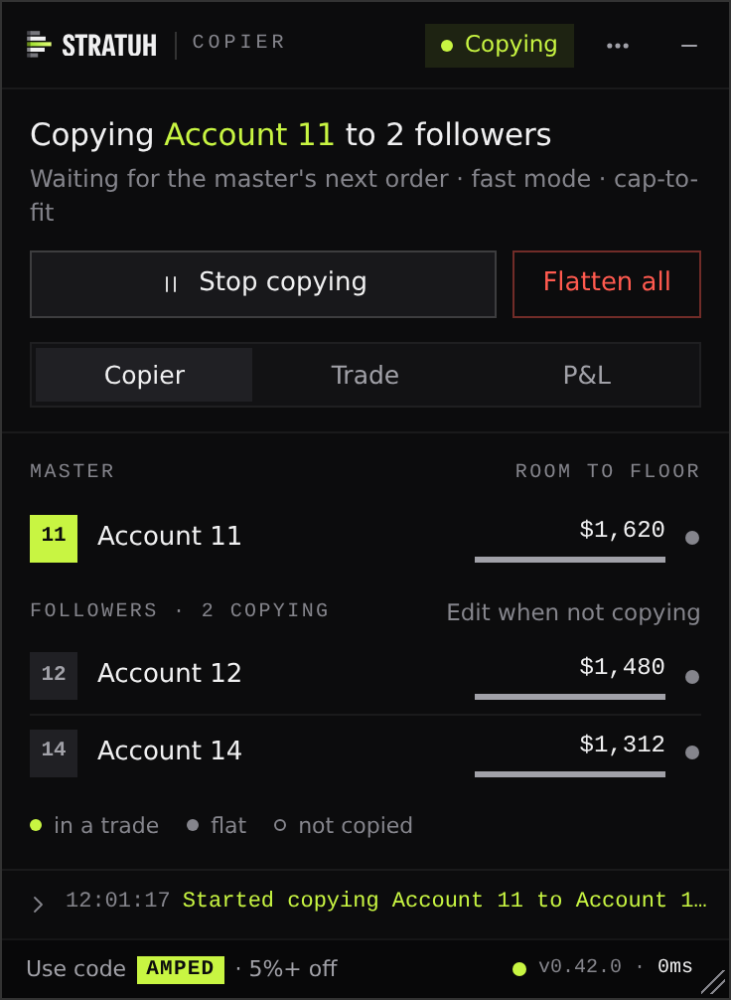
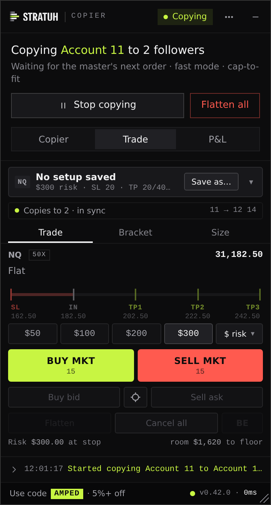
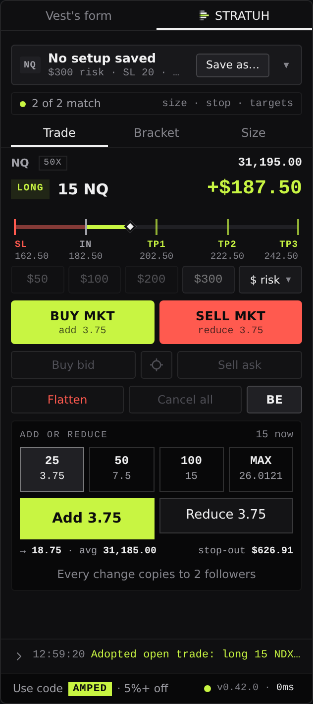

# STRATUH Copier

Trade one Vest account and your other accounts take the same trade, live. It's a Tampermonkey userscript that runs
inside the [Vest Markets](https://next.vestmarkets.com) page, part of STRATUH, my trading tools. It used to be called
Vest Copier: same script, same install link, new look.

New here? Start at [stratuh.com](https://stratuh.com) and the [5-minute video](https://youtu.be/2halihW34fc), or the
[one-page quick start](docs/Vest-Copier-Quick-Start.pdf). Every button is in the [user guide](docs/USER-GUIDE.md).

<table>
  <tr>
    <th>Accounts</th><th>Trade</th><th>In a trade</th>
  </tr>
  <tr valign="top">
    <td> Who copies whom, in one sentence.</td>
    <td> Points in, prices out.</td>
    <td> Your bracket on one bar.</td>
  </tr>
</table>

Balances, P&L and fills update live, straight from Vest's own feed, and an account that fails drops out by itself.

Name an account on Vest and the panel shows that name. If a follower's size, stops or targets ever stop matching the
master's, the log names the account so you can fix it on Vest.

Followers size to their own account by default (Cap-to-fit): a smaller account trades a smaller size. Same-size
accounts trade the same size. Switch to strict 1:1 in Edit if you want identical contracts everywhere.

> [!WARNING]
> These are live orders on real accounts. While it's copying, whatever you do on the master happens on every
> follower, mistakes included. Try it with the minimum size before anything else.

## Share your day

Good session? **P&L → Share** turns it into a picture you can paste straight into X, Discord or a group chat: today's
total across your accounts with a summary of your trades (or the latest ones), or one trade with every exit and when it happened (any trade from the
last 30 days that made money), or everything Vest has paid you out, with your last 8 weeks. You can show percentages
instead of dollars and put your @name on it. No account numbers on any of them.

<table>
  <tr>
    <th>Today</th><th>One trade</th>
  </tr>
  <tr valign="top">
    <td> The day, from Vest's own numbers.</td>
    <td> Every exit, to the second.</td>
  </tr>
</table>

## Getting it running

**Use Chrome on a computer.** It's the recommended browser: every release is tested on Chrome before it ships. Edge
and Brave are built on Chrome and behave the same. Firefox works, but isn't tested the same way. Five steps, about five
minutes:

1. **Add Tampermonkey from your browser's store.** It's free; click **Add** on the store page.
   - Chrome or Brave: [Chrome Web Store](https://chromewebstore.google.com/detail/tampermonkey/dhdgffkkebhmkfjojejmpbldmpobfkfo)
   - Edge: [Edge Add-ons](https://microsoftedge.microsoft.com/addons/detail/tampermonkey/iikmkjmpaadaobahmlepeloendndfphd)
   - Firefox: [Firefox Add-ons](https://addons.mozilla.org/firefox/addon/tampermonkey/)

   Get it from the store links above, not from download buttons on other sites (some are ads for other software).
2. **Chrome, Edge or Brave only:** go to `chrome://extensions`, click **Details** under Tampermonkey and switch
   **Allow User Scripts** on. It's off by default, and the copier won't run without it. No such switch? Use
   **Developer mode** instead: its switch is at the page's top right. Firefox skips this step.
3. **Install the copier:** open
   **[vest-copier.user.js](https://github.com/xAmped/Vest-Copier/releases/latest/download/vest-copier.user.js)**.
   Tampermonkey shows an install page. Click **Install**.
4. **Open Vest:** log in at [next.vestmarkets.com](https://next.vestmarkets.com). The STRATUH Copier panel opens on
   Vest's chart, on the left. Read the risk notice and accept it.
5. **Pick your accounts and start:** the panel asks you to choose accounts. Pick your lead account as the master and
   tick each account you want copying it, then press **Turn on** (in the bar, or **Turn on copying** in Accounts). From now on, trade the lead account as usual.
   **Stop copying** stops; positions stay as they are.

> [!TIP]
> Stuck? Watch the [video](https://youtu.be/2halihW34fc) or ask in the [Discord](https://discord.gg/Aa69y9KnM3).

## The panel

Since v0.42 the copier sits **inside Vest's page**. A slim bar in Vest's header says whether you're copying and who
copies to whom (11 → 12 14 15 16), with today's P&L, **Turn on** / **Turn off**, a red **Flatten all** and **Menu**.
The order panel takes Vest's order card, with a switch on top to go back to Vest's own form any time. Where Vest's
card isn't there (a narrow window, Vest's other pages), it's the floating panel on the chart, as before.

| Tab | What's there |
|---|---|
| **Trade** | Your saved setup, quantity buttons, BUY / SELL at market, Buy bid / Sell ask, limits and stop entries from the chart, Flatten, Cancel all, BE, and in a trade Add or reduce. |
| **Bracket** | Your stop, targets (with how they split) and when the stop moves to breakeven, one row each, in points with what each is worth. |
| **Size** | What the quantity buttons count (micros, minis, contracts, a % of the max or dollars at risk) and their values, and what the account can open. |

**Menu** has **Accounts** (your master, the followers and anyone left out, with the room to each floor, and **Turn on
copying**), **P&L and Share** (today's P&L, what you keep after each profit split, a picture of your day or of any
profitable trade from the last 30 days, and **Claim all profit**), **Settings**, **Appearance**, **Help and rules**
and **Report a problem**.

**Trading from it:**

- **Saved setups:** size, stop, targets, split and breakeven under one name per market; pick one and it's all set.
- **One line says if copying is in sync,** and turns amber naming the account when a follower's size or stop differs.
- **Points in, dollars out:** your bracket shows what it costs and makes before you click, and the same bracket is
  drawn on Vest's chart; drag a line to change it. The stop and targets are optional.
- **Limits and stop entries:** one click on Vest's chart places them. Stop entries (a buy stop over the market, a sell
  stop under it) are kept by the copier, since Vest doesn't have them: they fire while the Vest tab is open.
- **In a trade:** BUY / SELL add and reduce (never a reversal), your stop, entry, price and targets on one bar,
  **+ Add stop** / **+ Add target** (or right-click the chart at a price), BE and Flatten. Your stop stays where it is;
  your targets keep their prices and their sizes follow the position.

**Flatten all** closes everything on every account at once (no confirmation, and copying keeps running, so it doubles
as a quick exit). At the bottom: the latest activity line (click for the log), then the code and a status dot with
your version and, while copying, your time to Vest. Click it for the last 5 minutes of readings, how close your last
copy filled, **Test connection**, Vest's build and the site check.

## Things it won't do

- It won't copy a trade you placed while it wasn't copying, and it won't open a follower into a trade that's already
  running. (If master and followers already hold the same position, starting takes it over.)
- It won't copy an order Vest rejected on the master.
- It won't copy closes Vest makes by itself, such as a stop filling or a drawdown breach on the master. The log tells
  you what Vest did, and a follower still in the trade a few seconds later gets a Flatten / Keep prompt.
- It won't move your stop or targets when you add or reduce. Move them yourself on the chart.
- It won't keep a stop order once its Vest tab is closed or reloaded: stop orders live in the tab (the log says when
  one is cancelled). Vest's own orders (market, limit, your stop and targets) stay on Vest either way.
- It won't let you change the master, followers or Cap-to-fit while copying, or start in a second Vest tab while one
  is already copying. Stop first.
- It won't start right after Vest changes its website until its quick read-only check has passed (it runs by itself
  in a few seconds).

## Troubleshooting

| Symptom | Fix |
|---|---|
| No panel on the Vest page | Allow User Scripts is off (step 2 of Getting it running), or the script is disabled in Tampermonkey. Refresh after fixing. |
| Can't tick a follower | That account is a different size from the master. Pick Cap-to-fit under Sizing in Edit. |
| Turn on refuses | The log names the account and the reason, usually a resting order or an opposite position. Clear it on Vest and start again. |
| "did NOT fill" in the log | Vest accepted the order but didn't execute it, usually not enough margin for that size. The margin bar on the Trade tab shows how much fits. |
| Breakeven stays grey | Price has to be clear of your entry first (Vest refuses a stop the price has already passed). Hover it for the reason. |
| Amber status dot | Vest updated its site and the copier is checking itself. Give it a few seconds. If it says copying is off, send the file from the log's **Download** and use Vest's own panel until an update. |
| Something looks off on Firefox | Try the same thing in Chrome. Every release is tested on Chrome; if it only happens on Firefox, say so in your report. |
| Need a hand | Ask in the [Discord](https://discord.gg/Aa69y9KnM3). |
| Anything else | **Menu › Report a problem** (or **Get help** next to a problem). It saves a report file and opens a pre-filled [GitHub issue](https://github.com/xAmped/Vest-Copier/issues); drag the file in. The file has sizes, prices and balances but no login data. |

## Updates

New versions show up as a row above the activity line. Click **Install**, confirm in Tampermonkey, switch back to Vest and
the page reloads with the new version (while copying, it asks first: **Reload now**). The [changelog](CHANGELOG.md) lists what each one changed, and the
[roadmap](ROADMAP.md) what's coming next.

If a version turns out to have a problem, I can pause new trades from here while the fix ships. The panel shows
**Paused** with a short note, usually asking you to install the newest version. Stop orders waiting in the tab are
cancelled; trades already open keep copying their exits, and Flatten all always works. A one-line message
(Vest maintenance, a heads-up before news) sometimes shows under the header too; × dismisses it.

## About the AMPED code

The copier doesn't cost anything. I keep it running in my spare time, so if you were going to buy a Vest evaluation anyway,
code **AMPED** takes at least 5% off and sends a small commission my way.

It's your call, and the copier works the same either way. The panel asks whether to use the code, and asks again after
updates. Say yes and the copier puts AMPED in Vest's discount field each time you open a purchase window, including over
another code. You confirm it at your next checkout and see a short note after that. A code you type or pick yourself
stays for that purchase window. If your Vest account has no code at all, yes also links it to AMPED for good, because Vest doesn't
let that link change. Say no and the copier leaves the field alone. Settings → Support the copier changes your answer
any time.

## Privacy

The script runs in your browser tab and uses the Vest session you're already logged into. Your orders go to Vest and
nowhere else. Outside Vest it only reads public files: this repository's latest release, to see if there's a newer
version, and a small status file every few minutes (how I can pause new trades if a version has a problem). Only when
you open Share, it also loads three fonts from jsDelivr to draw the picture. Nothing about you or your accounts goes
with any of them.

## Terms

Use it on your own accounts and pass it along unchanged, both free. Selling it, renaming it or releasing an edited
copy is off limits. The full wording lives in [LICENSE](LICENSE), and [DISCLAIMER.md](DISCLAIMER.md) covers the risk
you take on by using it. Independent project by xAmped; Vest Markets has no part in it.
